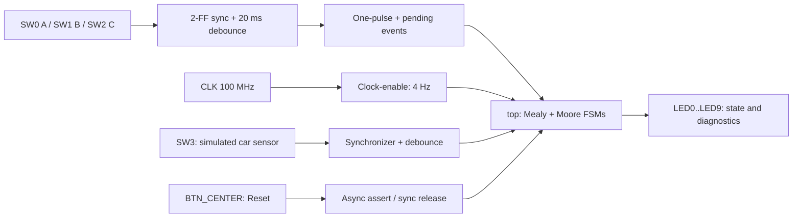

# FSM Parking System | Mealy + Moore on Basys 3

**FPGA implementation of a parking barrier controller using SystemVerilog, finite-state machines, switch input conditioning, and Vivado 2018.1.**

> Original circuit: Logisim Evolution | Target: Digilent Basys 3 (Artix-7 XC7A35T) | Design language: SystemVerilog | Physical clock: 100 MHz


## Project overview

This project migrates a logic-gate parking barrier design from Logisim to synthesizable SystemVerilog and a physical Xilinx Artix-7 FPGA. It combines:

- **Mealy FSM**: checks the A -> C -> B sequence and provides code/progress/alarm signals.
- **Moore FSM**: controls CLOSED -> OPENING -> OPEN -> CLOSING -> CLOSED.
- **Basys 3 interface**: two-flip-flop input synchronization, 20 ms debouncing, one-pulse events, reset synchronization, and a 4 Hz clock-enable for visible state transitions.
- **Validation**: behavioral XSim simulation, elaborated RTL, synthesis, place-and-route, post-implementation timing analysis, bitstream generation, and successful physical FPGA programming with Digilent FPGA Utility.

The `SENSOR` signal is simulated with a switch; this project does **not** use an external car-detection sensor or a real barrier motor.

## Hardware demo and verification

<p align="center"></p>

The bitstream `top_basys3.bit` was uploaded to the detected `XC7A35T` using Digilent FPGA Utility. The programming log reported `done in 2.113 sec`.

<p align="center"></p>

**Implementation results (Vivado 2018.1, `top_basys3`, 100 MHz clock):**

| Metric | Post-implementation result | Interpretation |
|:--|--:|:--|
| Clock period constraint | 10.000 ns | 100 MHz input clock |
| Setup WNS | **+5.669 ns** | Setup constraint met |
| Setup TNS | **0.000 ns** | No aggregate negative setup slack |
| Hold WHS | **+0.122 ns** | Hold constraint met |
| Hold THS | **0.000 ns** | No aggregate negative hold slack |
| Pulse-width slack | **+4.500 ns** | Clock pulse-width checks met |
| Failing endpoints | **0** | No reported timing failures in the displayed summary |
| Bitstream | **Generated** | Vivado `write_bitstream Complete` |
| Physical programming | **Completed** | Digilent FPGA Utility detected Basys 3 |


**Timing scope:** These measurements belong to the *FPGA implementation*, not to discrete SN74HC chips. The XDC constrains the 100 MHz clock; it does not define external input/output delays. The positive slack therefore proves that the *reported constrained timing paths* meet the applied constraints, not that all board-level timing has been characterized.

The repository's earlier discrete-gate analysis estimated **5.952 MHz** for one SN74HC74/04/08/32 feedback path; this is a separate, analytical calculation and must not be compared as the same hardware implementation. See [legacy timing analysis](docs/ANALISIS_TEMPORAL_SN74HC.md).

## Design architecture



The `tick_enable` module does **not** generate a new physical clock: it creates a one-cycle `CE` pulse on the same 100 MHz clock domain. The FSMs advance at approximately **4 updates/second (250 ms per update)**. Debounced button/switch events are held until the next update and then consumed once. Several keys pressed within one interval are not queued in order; enter A, C, and B separately.

## State machines

| FSM | Binary state | Meaning |
|:--|:--:|:--|
| Mealy | `00` | Waiting for A |
| Mealy | `01` | A accepted; waiting for C |
| Mealy | `10` | A,C accepted; waiting for B |
| Moore | `00` | CERRADA (closed) |
| Moore | `01` | ABRIENDO (opening) |
| Moore | `10` | ABIERTA (open) |
| Moore | `11` | CERRANDO (closing) |

Once the A -> C -> B sequence is accepted, the Moore FSM starts opening. SW3 is used as a **vehicle-presence simulation**: `1` keeps the barrier open and `0` allows the closing sequence.

## Basys 3 pin map

| Input | Pin | Physical component | Output | Pin | Physical component |
|:--|:--|:--|:--|:--|:--|
| `CLK` | W5 | 100 MHz oscillator | `CERRADA` | U16 | LD0 |
| `RST` | U18 | BTN_C | `ABRIENDO` | E19 | LD1 |
| `A` | V17 | SW0 | `ABIERTA` | U19 | LD2 |
| `B` | V16 | SW1 | `CERRANDO` | V19 | LD3 |
| `C` | W16 | SW2 | `CODIGO_OK` | W18 | LD4 |
| `SENSOR` | W17 | SW3 | `ALARMA` | U15 | LD5 |
|  |  |  | `PASO_1` | U14 | LD6 |
|  |  |  | `PASO_2` | V14 | LD7 |
|  |  |  | `Q0` | V13 | LD8 |
|  |  |  | `Q1` | V3 | LD9 |

**Physical test:** set SW0-SW2 low; press BTN_C; set SW3 high; toggle SW0 high/low (A), SW2 high/low (C), and SW1 high/low (B), leaving at least ~0.5 s between letters. The barrier should move from LD0 (closed) through LD1 (opening) to LD2 (open). Set SW3 low to allow closing (LD3, then LD0). `CODIGO_OK` can be a brief pulse and may not be visually obvious on an LED.

## Source tree

```text
FSM-Parking-Verylog/
├── README.md                         # Project overview + figures
├── .gitignore                        # Excludes local Vivado output
├── FSM-Parking-Verylog.code-workspace
├── .vscode/                          # VS Code workspace tasks/settings
├── circuito/                         # Original Logisim circuit (already in repo)
├── analisis/                         # SN74HC timing spreadsheet (already in repo)
├── evidencias/
│   ├── logica_moore.png              # Original evidence (already in repo)
│   ├── registros_moore.png           # Original evidence (already in repo)
│   └── fpga/                         # XSim, RTL, synthesis, routing, timing, hardware
├── hdl/
│   ├── src/
│   │   ├── top_basys3.sv             # Physical FPGA top
│   │   ├── top.sv                    # Mealy/Moore core
│   │   ├── mealy.sv / moore.sv
│   │   ├── tick_enable.sv
│   │   ├── debounce_onepulse.sv
│   │   └── reset_sync.sv
│   ├── sim/
│   │   ├── testbench.sv
│   │   └── testbench_basys3.sv
│   └── constraints/basys3.xdc
└── docs/
    ├── EVIDENCIAS_FPGA.md
    ├── ANALISIS_TEMPORAL_SN74HC.md
    └── GUIA_VIVADO_GITHUB.md
```

The files under `circuito/`, `analisis/` and the two original evidence images already exist on GitHub; **retain them** when copying this update over an existing clone.

## Reproduce in Vivado 2018.1

1. Clone this repository and open its folder in **Visual Studio Code** (`code .`).
2. Launch **Vivado 2018.1** and create/open an RTL project for `xc7a35tcpg236-1`.
3. Add all files in `hdl/src/` as **Design Sources**. Set `top_basys3` as the **synthesis top**.
4. Add `hdl/sim/testbench_basys3.sv` as **Simulation Sources** and set `testbench_basys3` as **simulation top**.
5. Add `hdl/constraints/basys3.xdc` as the **only active copy** of those pin constraints.
6. Run **Behavioral Simulation** and enter `run all` in the simulator Tcl console; check for the expected `PASS` message. A visible waveform alone is not proof that all assertions completed.
7. Run **RTL Analysis -> Synthesis -> Implementation -> Report Timing Summary -> Generate Bitstream**.
8. Connect the Basys 3 over PROG/UART USB. Load `top_basys3.bit` via **Digilent FPGA Utility** (used successfully) or Vivado Hardware Manager if detected.

For screenshots and what each one demonstrates, see **[FPGA evidence and interpretation](docs/EVIDENCIAS_FPGA.md)** or **[Spanish summary](docs/RESUMEN_ES.md)**. For setup and Git workflow, see **[Vivado + VS Code guide](docs/GUIA_VIVADO_GITHUB.md)**.

## Evidence

### Behavioral simulation (XSim)


This screenshot displays `CLK`, `SENSOR`, `A`, and the barrier signals during a limited simulation interval. The FSM is initially in `CERRADA`; to demonstrate the complete A -> C -> B behavior, run `run all` and capture the testbench's final `PASS` output.

### RTL analysis: elaboration


The elaborated RTL contains the input synchronizers, one-shot/debounce filters, clock-enable generator, reset synchronizer, and the core Mealy/Moore FSM modules. This is a logic connectivity diagram rather than a routed physical netlist.

### Synthesis


Vivado reported `Synthesis successfully completed`. Synthesis transformed the SystemVerilog modules into a device-dependent logic netlist. The screenshot validates completion, but does not provide an updated LUT/FF breakdown; obtain that separately from **Report Utilization**.

### Implementation: placement and routing


The Artix-7 device view shows clock regions and highlighted mapped resources. Implementation assigns resources to positions in the FPGA and routes signals between them. A [second device-view capture](evidencias/fpga/04_dispositivo_vivado.png) is included as supporting evidence.

### Timing and bitstream


The timing summary shows +5.669 ns setup WNS and +0.122 ns hold WHS with zero reported failing endpoints. The successful `top_basys3.bit` upload is documented earlier on this page and in [the evidence details](docs/EVIDENCIAS_FPGA.md).

## Constraints and limitations

- Physical switches are used as keyboard inputs and a vehicle-presence sensor emulator; there is **no external sensor, actuator or motor driver**.
- Input stabilization and one-shot key capture reduce human-input issues, but cannot guarantee an ordering when several keys arrive within the same 250 ms window.
- The testbench uses reduced divider/debounce parameters to simulate quickly; it does not run 100 million cycles/second in simulation.
- The XSim screenshot records only a *time slice* and does not itself establish that the whole testbench printed `PASS`.
- Do not report the old **10 LUT / 4 FF** utilization figure as the updated design's usage: it belonged to the initial design without the input-conditioning modules. Obtain the latest values with `Report Utilization` for `top_basys3`.
- The bitstream is programmed into volatile configuration memory; reprogram after power cycling unless boot flash is configured separately.

## Credits and references

- Project repository: [Josemedinan/FSM-Parking-Verylog](https://github.com/Josemedinan/FSM-Parking-Verylog)
- Development: Vivado 2018.1, SystemVerilog, Visual Studio Code, XSim, Digilent FPGA Utility
- Board: [Digilent Basys 3](https://digilent.com/reference/programmable-logic/basys-3/start)
- Original timing-data sources: [Texas Instruments SN74HC74](https://www.ti.com/lit/gpn/sn74hc74), [SN74HC04](https://www.ti.com/lit/ds/symlink/sn74hc04.pdf), [SN74HC08](https://www.ti.com/lit/gpn/sn74hc08), [SN74HC32](https://www.ti.com/lit/gpn/sn74hc32)
