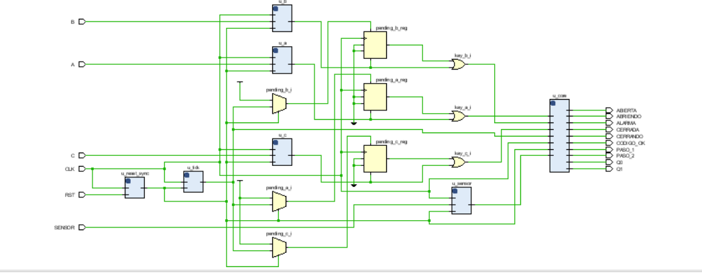
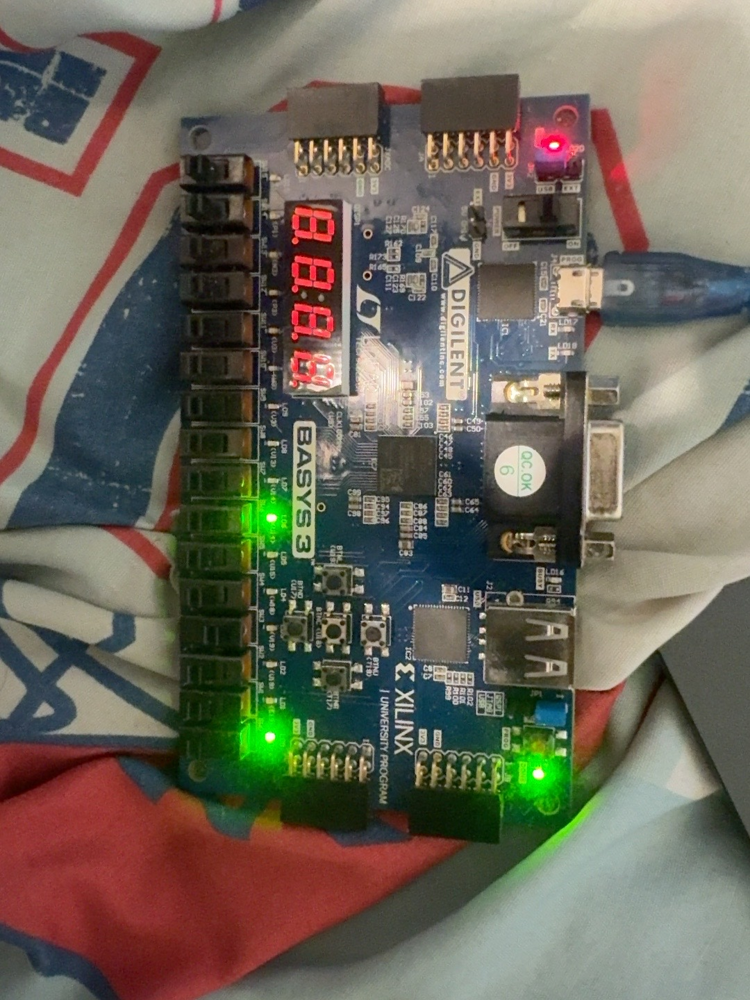
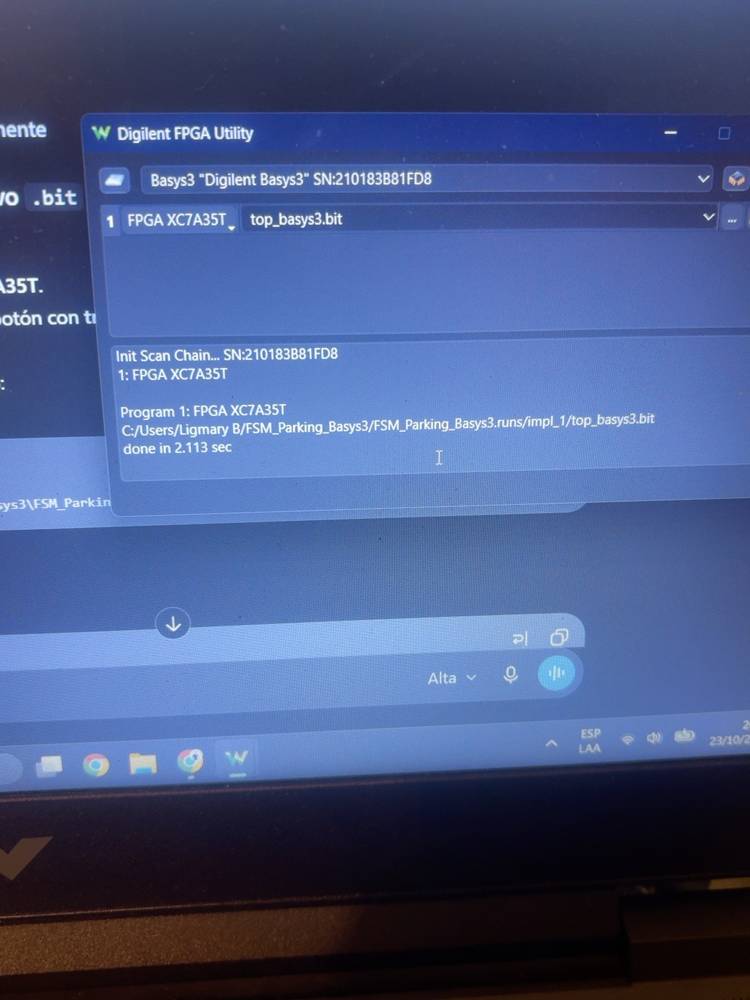
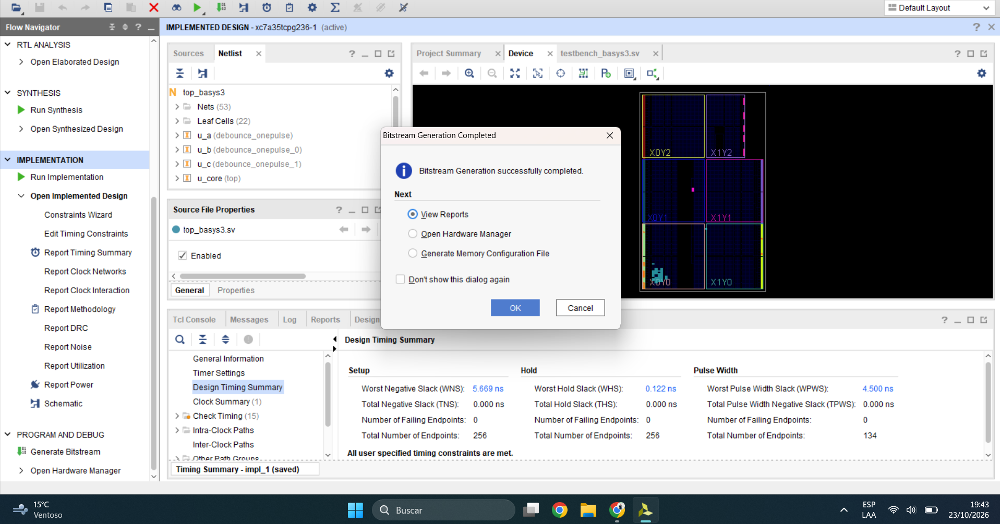
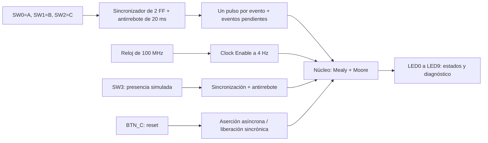
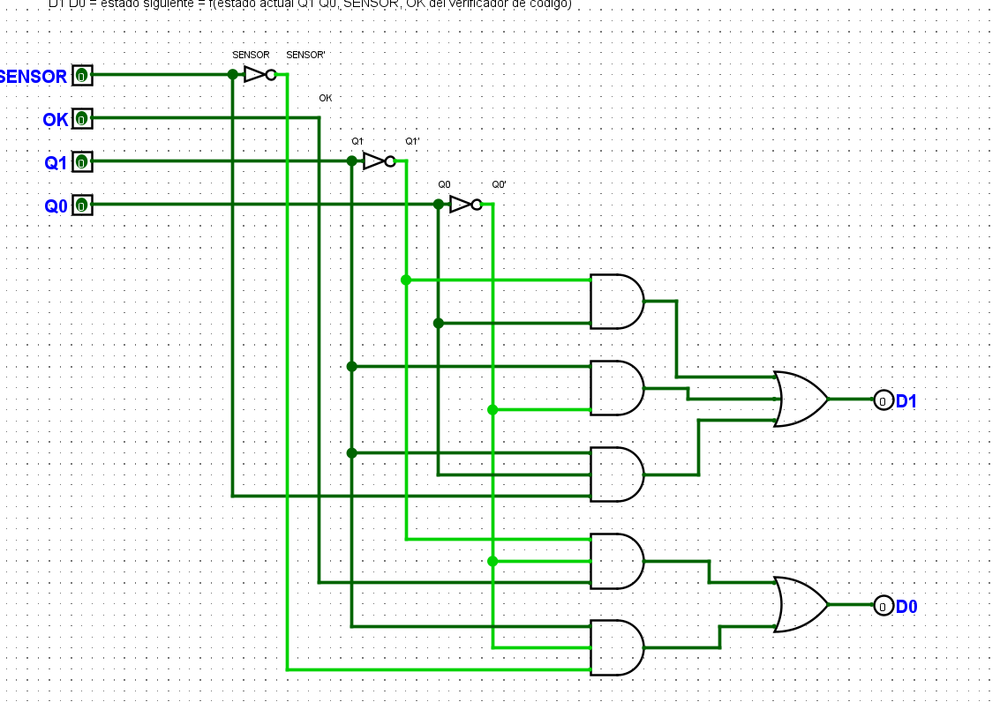
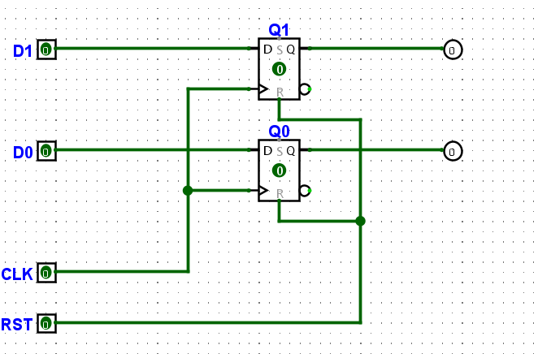
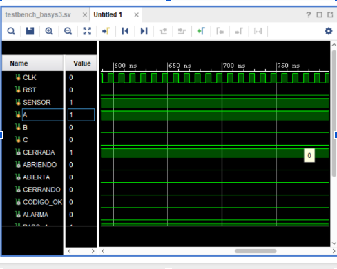
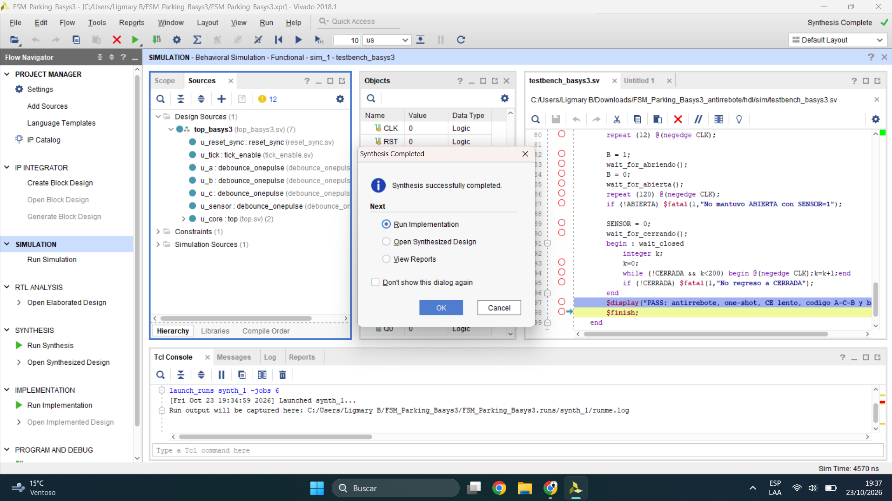
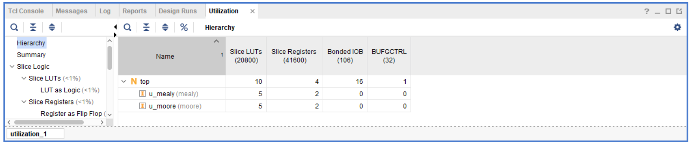

# Sistema de estacionamiento con FPGA | FSM Mealy + Moore

**Diseño e implementación de un controlador de barrera de estacionamiento en SystemVerilog, desde su circuito lógico en Logisim Evolution hasta su funcionamiento en una FPGA Digilent Basys 3.**

> **Placa:** Digilent Basys 3 | **FPGA:** Xilinx Artix-7 XC7A35T (`xc7a35tcpg236-1`) | **Herramientas:** Vivado 2018.1, XSim, Visual Studio Code y Digilent FPGA Utility | **Reloj físico:** 100 MHz



## 1. Descripción del proyecto

Este proyecto implementa un sistema digital de control de acceso a un estacionamiento. La barrera se activa al ingresar la secuencia correcta **A -> C -> B** y utiliza una señal `SENSOR` para decidir cuándo puede comenzar a cerrarse. El diseño original se construyó con compuertas y registros en **Logisim Evolution**, se describió posteriormente en **SystemVerilog** y finalmente se sintetizó, implementó y programó en una **Basys 3**.

El sistema combina dos máquinas de estados finitos:

- **FSM Mealy:** verifica la secuencia A -> C -> B, señala el avance de la contraseña y produce `CODIGO_OK` o `ALARMA` según las entradas.
- **FSM Moore:** controla los cuatro estados de la barrera: `CERRADA`, `ABRIENDO`, `ABIERTA` y `CERRANDO`.

Para poder usar interruptores reales en la FPGA se agregó una etapa de **sincronización de entradas, antirrebote, detección de eventos, sincronización de reset y habilitación de reloj lenta (Clock Enable)**.

**Alcance físico:** los interruptores de la Basys 3 simulan el teclado y la presencia de un vehículo. Los LEDs muestran los estados. No se conectó un sensor automotriz externo, un motor ni un actuador de barrera.


## https://youtu.be/tzXl0J6Dwy0 Enlace de explicacion
## 2. Demostración física y resultados generales

<p align="center">
  
</p>

El archivo **`top_basys3.bit`** se cargó sobre la FPGA **XC7A35T** utilizando **Digilent FPGA Utility**. El registro de programación mostró `done in 2.113 sec`, confirmando la transferencia exitosa del bitstream. La placa también se probó manualmente; estas pruebas iniciales no sustituyen una verificación exhaustiva de todos los casos posibles.

<p align="center">
  
</p>

### Resultados de temporización después de Implementation

| Parámetro | Resultado | Interpretación |
|:--|--:|:--|
| Período del reloj | **10.000 ns** | Reloj físico de 100 MHz |
| Setup WNS | **+5.669 ns** | Los caminos de setup analizados cumplen |
| Setup TNS | **0.000 ns** | No se acumula slack negativo de setup |
| Hold WHS | **+0.122 ns** | Los caminos de hold analizados cumplen |
| Hold THS | **0.000 ns** | No se acumula slack negativo de hold |
| Slack de ancho de pulso | **+4.500 ns** | Comprobación de ancho de pulso satisfecha |
| Endpoints fallidos reportados | **0** | No se reportaron violaciones en el resumen mostrado |
| Generación de bitstream | **Completada** | Vivado finalizó `write_bitstream` |
| Programación física | **Completada** | Digilent FPGA Utility identificó la Basys 3 |



**Cómo interpretar el timing:** un WNS positivo indica margen favorable respecto al límite de setup definido; un WHS positivo indica margen favorable respecto al límite de hold en los caminos analizados. El archivo XDC establece el reloj de 100 MHz, pero no incluye retardos externos de entrada/salida. Por lo tanto, estos resultados **validan los caminos restringidos que reportó Vivado**, no todos los tiempos de una instalación de estacionamiento real.

## 3. Arquitectura del sistema



### 3.1. Por qué agregamos un antirrebote

Los interruptores y pulsadores mecánicos pueden producir transiciones eléctricas no deseadas durante su accionamiento. Sin filtrado, una sola entrada puede interpretarse varias veces. El módulo `debounce_onepulse.sv` estabiliza la señal y genera un evento único por activación. Además, un sincronizador de dos flip-flops reduce el riesgo de problemas al incorporar señales externas al dominio de reloj de la FPGA.

El antirrebote está configurado a **20 ms**. A 100 MHz, ese intervalo equivale aproximadamente a:

$$
N_{\mathrm{antirrebote}} = 100\times10^6\,\frac{\mathrm{ciclos}}{\mathrm{s}}\times 0.020\,\mathrm{s} = 2{,}000{,}000\ \mathrm{ciclos}
$$

### 3.2. Divisor de frecuencia mediante Clock Enable

El módulo `tick_enable.sv` **no crea un segundo reloj físico**: mantiene el dominio de 100 MHz y produce una señal `CE` que se activa durante un ciclo cada 250 ms. De esta manera, las FSM avanzan aproximadamente cuatro veces por segundo y las transiciones se pueden observar en los LEDs.

$$
N_{\mathrm{CE}} = \frac{f_{CLK}}{f_{CE}} = \frac{100{,}000{,}000}{4} = 25{,}000{,}000\ \mathrm{ciclos}
$$

$$
T_{\mathrm{CE}} = \frac{1}{4\ \mathrm{Hz}} = 0.25\ \mathrm{s} = 250\ \mathrm{ms}
$$

Los eventos de tecla se mantienen pendientes hasta la siguiente habilitación y se consumen una sola vez. **Si se activan varias letras dentro del mismo intervalo de 250 ms, no se garantiza conservar su orden**; por ello, el código debe introducirse letra por letra.

### 3.3. Organización de los módulos

| Archivo | Responsabilidad |
|:--|:--|
| `hdl/src/top_basys3.sv` | Módulo superior conectado a las entradas/salidas físicas de la Basys 3 |
| `hdl/src/top.sv` | Integra las FSM Mealy y Moore |
| `hdl/src/mealy.sv` | Verificación de A -> C -> B y señales de alarma/progreso |
| `hdl/src/moore.sv` | Control de los cuatro estados de la barrera |
| `hdl/src/debounce_onepulse.sv` | Sincronización, filtrado de rebote y generación de pulsos |
| `hdl/src/tick_enable.sv` | Habilitación de avance a 4 Hz sin generar otro reloj |
| `hdl/src/reset_sync.sv` | Aserción asíncrona y liberación sincronizada de reset |
| `hdl/constraints/basys3.xdc` | Asignación de pines físicos y restricción del reloj |

## 4. Diseño de las máquinas de estados

### 4.1. FSM Mealy: validación del código

La máquina Mealy reconoce la secuencia **A, después C y finalmente B**. Sus salidas combinacionales dependen tanto del estado como de las entradas presentes.

| Estado | Codificación | Significado |
|:--|:--:|:--|
| Espera | `00` | Aún no se ha introducido A |
| Paso 1 | `01` | Se aceptó A; falta C |
| Paso 2 | `10` | Se aceptaron A y C; falta B |

Al reconocer B en el estado correspondiente, la señal `CODIGO_OK` habilita el cambio de estado de la FSM Moore. La salida `ALARMA` identifica combinaciones no permitidas definidas en la lógica original. Las señales `PASO_1` y `PASO_2` permiten observar el avance del código.

### 4.2. FSM Moore: control de la barrera

La máquina Moore utiliza cuatro estados codificados con dos bits. Sus salidas dependen del estado almacenado:

| Estado | Codificación (`Q1 Q0`) | LED principal | Significado |
|:--|:--:|:--|:--|
| `CERRADA` | `00` | LD0 | Barrera en reposo, esperando un código correcto |
| `ABRIENDO` | `01` | LD1 | Inicio del movimiento de apertura |
| `ABIERTA` | `10` | LD2 | Barrera abierta |
| `CERRANDO` | `11` | LD3 | Movimiento de cierre |

Tras validar A -> C -> B, la FSM Moore inicia la apertura. `SENSOR = 1` representa la presencia de un vehículo y permite mantener la barrera abierta; `SENSOR = 0` permite comenzar el cierre. Las transiciones se muestran mediante LEDs, no mediante un motor.

## 5. Análisis temporal con componentes reales de DigiKey

### 5.1. Objetivo y contexto

Antes de implementar el diseño en la FPGA se analizó una ruta secuencial de la **FSM Moore del circuito original de Logisim** usando componentes discretos de la familia **SN74HC** de Texas Instruments, comercializados por distribuidores como **DigiKey**.

El propósito era estimar el período mínimo permitido por la restricción de **setup**, la **frecuencia máxima aproximada** de esa ruta y comprobar la condición de **hold** bajo hipótesis explícitas. Este análisis de compuertas reales **no es el timing de la FPGA**.

### 5.2. Componentes seleccionados

| Componente | Referencia de Texas Instruments | Función en la ruta | Dato temporal utilizado |
|:--|:--|:--|:--|
| Flip-flop tipo D | **SN74HC74N** | Registros de estado | `CLK -> Q` máx.: 44 ns; setup: 25 ns; hold: 0 ns |
| Inversor NOT | **SN74HC04N** | Negación de Q1 | Retardo de propagación máx.: 24 ns |
| Compuerta AND de 2 entradas | **SN74HC08N** | Función lógica intermedia | Retardo de propagación máx.: 25 ns |
| Compuerta OR de 2 entradas | **SN74HC32N** | Combinación de términos | Retardo de propagación máx.: 25 ns por etapa |

**Condiciones de referencia:** alimentación de 4.5 V y el intervalo de temperatura indicado en las hojas de datos empleadas en el análisis original (de -40 a 85 grados Celsius). Las cifras dependen de las condiciones de carga y de ensayo de cada ficha técnica. No se modelaron los retardos del cableado ni se midió el skew real del reloj.

**Consulta de componentes y hojas de datos:**

- **SN74HC74N (flip-flop D):** [hoja de datos de TI](https://www.ti.com/lit/gpn/sn74hc74) y [búsqueda en DigiKey](https://www.digikey.com/en/products?keywords=SN74HC74N).
- **SN74HC04N (NOT):** [hoja de datos de TI](https://www.ti.com/lit/ds/symlink/sn74hc04.pdf) y [búsqueda en DigiKey](https://www.digikey.com/en/products?keywords=SN74HC04N).
- **SN74HC08N (AND):** [hoja de datos de TI](https://www.ti.com/lit/gpn/sn74hc08) y [búsqueda en DigiKey](https://www.digikey.com/en/products?keywords=SN74HC08N).
- **SN74HC32N (OR):** [hoja de datos de TI](https://www.ti.com/lit/gpn/sn74hc32) y [búsqueda en DigiKey](https://www.digikey.com/en/products?keywords=SN74HC32N).

Estas referencias permiten reproducir el cálculo y consultar las condiciones completas de los retardos utilizados. No se presupone disponibilidad actual ni precio de inventario.

### 5.3. Camino secuencial seleccionado

Se analizó el camino de realimentación **Q1 -> D1** de la máquina Moore:

```text
Flip-flop de origen Q1
  -> NOT
  -> AND
  -> OR
  -> OR
  -> Flip-flop de destino D1
```

El circuito original contenía una función OR de tres entradas. Para implementarla con el **SN74HC32N**, que tiene compuertas OR de dos entradas, se consideraron **dos niveles OR en cascada**. Se trata de una suposición conservadora para la rama seleccionada, no de una medición física del circuito completo.

#### Evidencia del circuito original





### 5.4. Restricción de Setup Time

El **tiempo de setup** es el intervalo mínimo durante el cual la entrada D del flip-flop de destino debe permanecer estable **antes** del flanco activo de reloj. Para que la ruta funcione, el período del reloj debe ser suficiente para que el dato salga del registro de origen, atraviese la lógica combinacional y llegue a tiempo al registro de destino.

Con skew de reloj supuesto igual a cero:

$$
T_{CLK} \geq t_{CQ,\max} + t_{PD,\max} + t_{setup}
$$

En el camino seleccionado, el retardo combinacional incluye NOT, AND y dos niveles OR:

$$
T_{CLK} \geq t_{CQ,\max} + t_{NOT,\max} + t_{AND,\max} + 2t_{OR,\max} + t_{setup}
$$

**Sustitución numérica:**

$$
T_{CLK} \geq 44 + 24 + 25 + 2(25) + 25\ \mathrm{ns}
$$

$$
T_{CLK} \geq 44 + 24 + 25 + 50 + 25 = 168\ \mathrm{ns}
$$

$$
\boxed{T_{CLK,\min} \approx 168\ \mathrm{ns}}
$$

**Interpretación:** bajo las condiciones de referencia y las hipótesis de esta ruta, un reloj con un período inferior a 168 ns podría provocar que el dato llegue demasiado tarde y viole setup.

### 5.5. Frecuencia máxima estimada

La frecuencia es el inverso del período. Por tanto:

$$
F_{\max} = \frac{1}{T_{CLK,\min}}
$$

$$
F_{\max} = \frac{1}{168\times10^{-9}\ \mathrm{s}}
$$

$$
\boxed{F_{\max,\mathrm{ruta}} \approx 5.952\ \mathrm{MHz}}
$$

Este valor corresponde **únicamente al camino SN74HC Q1 -> D1** analizado. No certifica la frecuencia máxima global del conjunto Mealy + Moore: para eso habría que revisar todos los caminos secuenciales y sus condiciones eléctricas.

### 5.6. Restricción de Hold Time

El **tiempo de hold** indica cuánto tiempo debe permanecer estable la entrada D **después** del flanco activo del reloj. Una ruta demasiado rápida puede causar una violación incluso si se cumple setup.

La condición general es:

$$
t_{CQ,\min} + t_{CD,\min} \geq t_{hold} + t_{skew}
$$

Donde:

- $t_{CQ,\min}$: retardo mínimo desde CLK hasta Q del flip-flop de origen.
- $t_{CD,\min}$: retardo mínimo de contaminación de la ruta combinacional.
- $t_{hold}$: tiempo de retención exigido por el flip-flop de destino.
- $t_{skew}$: diferencia de llegada del reloj entre captura y lanzamiento, con la convención usada en esta expresión.

Para el análisis original se tomaron $t_{hold}=0\ \mathrm{ns}$ y $t_{skew}=0\ \mathrm{ns}$. Entonces:

$$
t_{CQ,\min} + t_{CD,\min} \geq 0
$$

Considerando retardos físicos no negativos, la desigualdad se cumple **bajo esas hipótesis**. Sin embargo, como no se dispone de todos los valores mínimos garantizados ni del skew medido, **no se puede establecer un margen numérico positivo ni certificar hold en una placa construida con esos componentes**.

### 5.7. Diferencia entre DigiKey/SN74HC y la FPGA

| Aspecto | Implementación discreta con SN74HC | Implementación FPGA Artix-7 |
|:--|:--|:--|
| Tecnología | Flip-flops y compuertas comerciales | LUTs, flip-flops internos y enrutamiento FPGA |
| Herramienta de evaluación | Hojas de datos y cálculo de ruta | Vivado 2018.1 Timing Analysis |
| Período | Mínimo estimado: **168 ns** para la ruta | Restricción aplicada: **10 ns** |
| Frecuencia | **5.952 MHz**, aproximación de la ruta | **100 MHz** de reloj físico verificado según restricciones |
| Setup | Estimado a partir de retardos máximos | **WNS +5.669 ns** |
| Hold | Condición analítica bajo supuestos | **WHS +0.122 ns** |
| Cobertura | Una ruta seleccionada | Caminos restringidos analizados por Vivado |

**No son frecuencias máximas comparables:** 5.952 MHz es una estimación de una ruta construida con componentes discretos; 100 MHz es la frecuencia **configurada y verificada** en la implementación FPGA, no una medida de la frecuencia máxima absoluta del dispositivo.

La explicación original ampliada también se conserva en [Análisis temporal SN74HC](docs/ANALISIS_TEMPORAL_SN74HC.md) y los datos tabulados en [`analisis/retardos.csv`](analisis/retardos.csv).

## 6. Conexiones de la Basys 3 (archivo XDC)

| Entrada | Pin FPGA | Componente físico | Salida | Pin FPGA | Indicador |
|:--|:--|:--|:--|:--|:--|
| `CLK` | W5 | Oscilador de 100 MHz | `CERRADA` | U16 | LD0 |
| `RST` | U18 | Botón central BTN_C | `ABRIENDO` | E19 | LD1 |
| `A` | V17 | SW0 | `ABIERTA` | U19 | LD2 |
| `B` | V16 | SW1 | `CERRANDO` | V19 | LD3 |
| `C` | W16 | SW2 | `CODIGO_OK` | W18 | LD4 |
| `SENSOR` | W17 | SW3 | `ALARMA` | U15 | LD5 |
| | | | `PASO_1` | U14 | LD6 |
| | | | `PASO_2` | V14 | LD7 |
| | | | `Q0` | V13 | LD8 |
| | | | `Q1` | V3 | LD9 |

### Prueba manual de apertura y cierre

1. Colocar **SW0, SW1 y SW2 en 0** y presionar brevemente **BTN_C** para reiniciar.
2. Colocar **SW3 en 1** para simular que el vehículo está en el paso de la barrera.
3. Subir y bajar **SW0 (A)** y esperar al menos medio segundo.
4. Subir y bajar **SW2 (C)** y esperar al menos medio segundo.
5. Subir y bajar **SW1 (B)** y observar la secuencia **LD0 -> LD1 -> LD2**.
6. Colocar **SW3 en 0** para permitir el cierre; deben aparecer los estados de **LD3** y posteriormente **LD0**.

`CODIGO_OK` puede durar muy poco y no siempre ser visible a simple vista en LD4. SW3 **simula** el sensor: no hay detector de automóviles externo instalado.

## 7. Estructura del repositorio

```text
FSM-Parking-Verylog/
|-- README.md                          # Documento principal, en español
|-- .gitignore                         # Ignora salidas locales de Vivado
|-- FSM-Parking-Verylog.code-workspace # Espacio de trabajo VS Code
|-- .vscode/                           # Configuración del editor
|-- circuito/                          # Circuito original de Logisim
|-- analisis/                          # Datos del estudio SN74HC
|   `-- retardos.csv
|-- evidencias/
|   |-- logica_moore.png
|   |-- registros_moore.png
|   `-- fpga/
|       |-- 01_simulacion_xsim.png
|       |-- 02_rtl_elaborado.png
|       |-- 03_implantacion_fpga.png
|       |-- 04_dispositivo_vivado.png
|       |-- 05_sintesis_completada.png
|       |-- 06_timing_summary.png
|       |-- 07_programacion_exitosa.jpg
|       |-- 08_basys3_fisica.jpg
|       `-- 09_utilizacion_version_inicial.png
|-- hdl/
|   |-- src/
|   |   |-- top_basys3.sv
|   |   |-- top.sv
|   |   |-- mealy.sv
|   |   |-- moore.sv
|   |   |-- debounce_onepulse.sv
|   |   |-- tick_enable.sv
|   |   `-- reset_sync.sv
|   |-- sim/
|   |   |-- testbench.sv
|   |   `-- testbench_basys3.sv
|   `-- constraints/
|       `-- basys3.xdc
|-- scripts/
`-- docs/
    |-- ANALISIS_TEMPORAL_SN74HC.md
    |-- EVIDENCIAS_FPGA.md
    |-- GUIA_VIVADO_GITHUB.md
    |-- RESUMEN_ES.md
    `-- CHECKLIST_ENTREGA.md
```

**Importante:** el circuito `circuito/barrera_codigo(1).circ`, los datos `analisis/` y las imágenes de la Moore forman parte del trabajo original. Se conservan para mostrar la evolución completa del proyecto.

## 8. Cómo reproducir el proyecto en Vivado 2018.1

1. Clonar el repositorio y abrir la carpeta en **Visual Studio Code** con `code .`.
2. Abrir **Vivado 2018.1** y crear un proyecto RTL para `xc7a35tcpg236-1`.
3. Agregar todos los archivos de `hdl/src/` como **Design Sources**; marcar **`top_basys3` como Top** para síntesis.
4. Agregar `hdl/sim/testbench_basys3.sv` en **Simulation Sources**, como **Top de simulación**.
5. Agregar `hdl/constraints/basys3.xdc` como el **único archivo activo** con estas asignaciones de pines, para evitar restricciones duplicadas.
6. Ejecutar **Run Simulation -> Run Behavioral Simulation**; en la consola Tcl del simulador ejecutar `run all` y verificar el resultado final del testbench. Ver las ondas por sí solas no prueba que todas las aserciones hayan pasado.
7. Ejecutar **RTL Analysis -> Run Synthesis -> Run Implementation -> Report Timing Summary -> Generate Bitstream**.
8. Conectar la Basys 3 por el puerto USB **PROG/UART** y cargar `top_basys3.bit` con **Digilent FPGA Utility** (método con el que se logró programar la placa), o con Vivado Hardware Manager si detecta JTAG.

Para instrucciones más detalladas, consultar [Guía de Vivado y VS Code](docs/GUIA_VIVADO_GITHUB.md) y [Evidencias FPGA](docs/EVIDENCIAS_FPGA.md).

## 9. Evidencias y explicación de las capturas

### 9.1. Simulación funcional (XSim)



Se observan las señales de reloj, reset y entradas del sistema en una parte de la simulación. El testbench permite comprobar la secuencia A -> C -> B y la activación de las salidas de la barrera. Esta imagen corresponde a un **intervalo parcial**: para certificar la verificación automatizada completa se debe guardar también la salida final `PASS` de la consola XSim.

### 9.2. Análisis RTL (elaboración)


La imagen muestra la conexión entre el acondicionamiento de entradas, el generador de Clock Enable, el módulo de reset y el núcleo Mealy/Moore. Esta vista representa la **estructura lógica** generada por Vivado antes de la distribución física; no es el plano de ubicación de las celdas en la FPGA.

### 9.3. Síntesis (Synthesis)



Vivado confirmó `Synthesis successfully completed`. La síntesis traduce las descripciones SystemVerilog a una red de recursos lógicos apropiados para la familia Artix-7. El mensaje verifica que **terminó esa etapa**, pero no informa en esta captura cuántas LUTs y flip-flops ocupa la versión final; esos valores deben obtenerse de **Report Utilization**.

### 9.4. Implementation: colocación y enrutamiento


En la vista de la Artix-7 se observan las regiones del dispositivo y recursos resaltados. **Implementation** realiza la colocación de los elementos sintetizados en recursos físicos de la FPGA y el enrutamiento de sus interconexiones. El proyecto conserva una [segunda vista del dispositivo](evidencias/fpga/04_dispositivo_vivado.png).

### 9.5. Timing Analysis y generación del bitstream


El reporte muestra **WNS +5.669 ns**, **WHS +0.122 ns** y ningún endpoint fallido reportado. Estos valores indican que el diseño satisfizo las restricciones de temporización analizadas por Vivado a **100 MHz**. Posteriormente se generó el archivo `top_basys3.bit` y su carga en la Basys 3 quedó documentada en las fotos de la sección 2.

### 9.6. Diferencia con la utilización de la versión inicial



La versión original sin acondicionamiento de entradas utilizaba **10 LUTs y 4 flip-flops**. La versión implementada con `top_basys3` integra contadores y filtros adicionales, por lo que **no se deben reutilizar** aquellos valores como si pertenecieran a la versión final. Para conocer el uso real de recursos actualizado, abrir **Report Utilization** después de Synthesis o Implementation con `top_basys3` como Top.

## 10. Limitaciones y mejoras futuras

- Los interruptores simulan el teclado y el detector de vehículos; falta integrar sensores y actuadores externos para controlar una barrera real.
- El filtrado antirrebote y la captura de un evento por activación mejoran la operación manual, pero no almacenan una cola ordenada si se ingresan varias letras en el mismo intervalo de 250 ms.
- Los testbenches utilizan parámetros temporales reducidos para evitar simulaciones innecesariamente largas; las capturas de ondas deben interpretarse con esa configuración.
- Falta conservar una captura específica de la salida `PASS` completa de XSim para dejar evidencia inequívoca de todas las pruebas automatizadas.
- Es recomendable generar y guardar el **Report Utilization** de la implementación final y los reportes de temporización completos.
- El archivo `.bit` se carga en memoria de configuración volátil. Para conservarlo tras apagar la placa se necesitaría una configuración de arranque desde memoria flash.
- En una versión destinada a un estacionamiento real sería necesario incluir protecciones de seguridad, control de un motor y verificación de fallos del sensor.

## 11. Conclusiones

El proyecto permitió pasar de un circuito de compuertas en Logisim a un sistema secuencial descrito en SystemVerilog e implementado en una FPGA real. Las FSM Mealy y Moore separan la validación del código y el control de la barrera, lo que facilita entender el funcionamiento y realizar pruebas por partes.

El análisis de componentes DigiKey complementa el diseño al mostrar cómo se calculan las restricciones de **setup, hold y frecuencia máxima** con retardos de componentes comerciales. Por otro lado, Vivado permitió realizar síntesis, colocación, enrutamiento y comprobación temporal para una implementación muy distinta: la FPGA Artix-7. Mantener ambos análisis separados evita confundir una estimación teórica de compuertas discretas con un reporte de temporización de FPGA.

La generación del bitstream y la programación exitosa de la Basys 3 demuestran que el diseño pudo llevarse al hardware. Quedan como tareas de documentación la captura final del `PASS` de simulación y el reporte de utilización de la versión con antirrebote.

## 12. Referencias

- [Repositorio FSM-Parking-Verylog](https://github.com/Josemedinan/FSM-Parking-Verylog)
- [Documentación oficial de Digilent Basys 3](https://digilent.com/reference/programmable-logic/basys-3/start)
- [DigiKey Electronics: catálogo de componentes](https://www.digikey.com/)
- [Texas Instruments, SN74HC74](https://www.ti.com/lit/gpn/sn74hc74)
- [Texas Instruments, SN74HC04](https://www.ti.com/lit/ds/symlink/sn74hc04.pdf)
- [Texas Instruments, SN74HC08](https://www.ti.com/lit/gpn/sn74hc08)
- [Texas Instruments, SN74HC32](https://www.ti.com/lit/gpn/sn74hc32)
- [Análisis temporal detallado de los componentes SN74HC](docs/ANALISIS_TEMPORAL_SN74HC.md)
- [Evidencias y explicaciones de las etapas FPGA](docs/EVIDENCIAS_FPGA.md)
