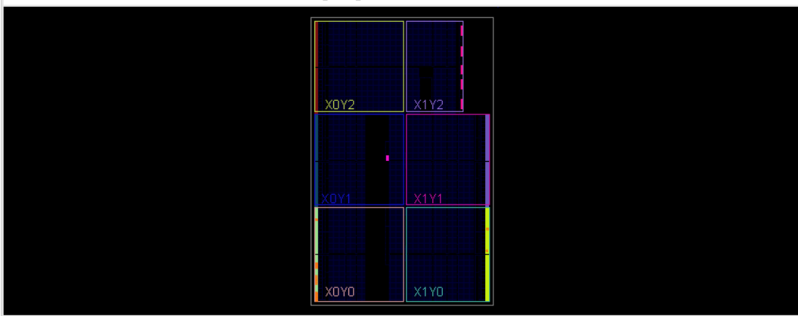

# FPGA evidence | FSM Parking

This page explains what each screenshot demonstrates. These are **screenshots from the user's Vivado/Digilent sessions**; they are not synthetic examples.

## 1. Behavioral simulation (XSim)

The waveform shows the 100 MHz-style simulation clock (parameterized testbench uses 10 ns per cycle), asserted `SENSOR`, input `A`, and the barrier's state/status outputs in a segment of simulation time. In this frame `CERRADA=1` and `ABRIENDO=ABIERTA=CERRANDO=0`. The window is only a portion of the run, not a complete assertion report. Run `run all` and confirm the `PASS` output to document complete testbench success.

## 2. RTL elaboration

This is the elaborated SystemVerilog block-level diagram. It includes the reset synchronizer (`u_reset_sync`), clock-enable generator (`u_tick`), button conditioning (`u_a`, `u_b`, `u_c`, `u_sensor`), pending-key registers and the Mealy/Moore core (`u_core`). The green nets illustrate structural connectivity; elaboration is not the same as final physical routing.

## 3. Synthesis

Vivado reports `Synthesis successfully completed` for the updated project. Synthesis maps RTL into a technology-specific netlist. Resource metrics should be taken from `Report Utilization` after compiling the updated `top_basys3` design. A previous iteration reported 10 LUTs/4 FFs; **those numbers do not describe the new debounce and clock-enable design**.

## 4. Implementation and FPGA floorplan

Vivado's device view shows the Artix-7 fabric divided into clock-region tiles such as X0Y0, X0Y1, X0Y2, X1Y0, X1Y1 and X1Y2. Highlighted cells/nets indicate where the tool mapped and routed this small design. The view does not show a motor, sensor, or physical parking system; it is the internal programmable logic layout.

## 5. Timing after implementation

| Check | Vivado result |
|:--|--:|
| WNS (setup) | +5.669 ns |
| TNS (setup) | 0.000 ns |
| WHS (hold) | +0.122 ns |
| THS (hold) | 0.000 ns |
| Worst pulse-width slack | +4.500 ns |
| Failing endpoints | 0 |

The report states that all **user-specified timing constraints** were met. The XDC clocks the design at 100 MHz (10 ns). No board-level input/output delay budget is given, so this is a valid clock-constrained internal FPGA report, not a full external-interface timing certification.

## 6. Programming evidence

Digilent FPGA Utility enumerated `Basys3`, identified the `XC7A35T`, and programmed `top_basys3.bit`, reporting `done in 2.113 sec`. This confirms a successful JTAG bitstream upload, not by itself a full functional test of every input or output.

The board was powered and observed after programming. Use SW0/SW2/SW1 to enter the A/C/B sequence, SW3 to simulate presence, BTN_C to reset, and LD0-LD9 for status. The 7-segment display is not controlled by the module presented here; illuminated segments in a photo are not a defined output of this design.

## 7. Legacy discrete-component analysis (separate hardware)

The previous implementation used 10 LUTs and 4 FFs. It is included solely as a historical baseline. The theoretical 5.952 MHz result using SN74HC components concerns a *discrete-gate timing path*, not this Artix-7 implementation. Refer to [legacy timing notes](ANALISIS_TEMPORAL_SN74HC.md).
